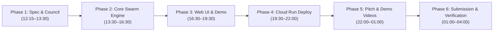

# GAME_PLAN.md: Berkeley x DeepMind Hackathon Orchestration
## Target: Hard Stop Submission by Sunday 08:00 CET (Midnight PT)

---

## 1. Timeline & Phased Execution

### Phase 1: Architecture & Foundation (12:15 – 13:30 CET)
- [x] Complete Hackathon Spec (`SPEC.md`) and Rubric Matrix (`JUDGES.md`).
- [ ] Draft Team One-Pager (`TEAM_ONE_PAGER.md`) and Idea One-Pager (`IDEA_ONE_PAGER.md`).
- [ ] Initialize clean Git repository with GitHub Actions CI pipeline.
- [ ] Finalize the core multi-agent architecture utilizing Antigravity CLI `/swarm` pattern.

### Phase 2: Multi-Agent Swarm Backend (13:30 – 16:30 CET)
- [ ] Build the core Gemini-powered swarm:
  - `agents/extractor.py`: Structured entity & protocol rule extraction.
  - `agents/analyzer.py`: Patient clinical data & phenotyping analysis.
  - `agents/safety_auditor.py`: Contradiction & medical safety checks.
  - `agents/verifier.py`: Reconciliation & deterministic citation audit.
- [ ] Automated eval suite on representative benchmark cases with verified ground truth.
- [ ] Ensure execution runs in < 15 seconds with zero hallucination via deterministic citation grounding.

### Phase 3: Interactive Public Web UI (16:30 – 19:30 CET)
- [ ] Clean, professional, high-contrast dashboard (Next.js or FastHTML / Streamlit / Tailwind UI).
- [ ] "30-Second Judge Experience":
  - 3 pre-loaded benchmark cases (Instant 1-click execution).
  - Live execution viewer showing the 4 agents working in parallel.
  - Clear outcome card: "Hours Saved: 3.5h | Safety Conflicts Caught: 2 | Status: ENROLLMENT BLOCKED (High AST/ALT)".

### Phase 4: Containerization & Cloud Run Deployment (19:30 – 22:00 CET)
- [ ] Dockerfile optimized for fast cold-starts.
- [ ] Deploy to Google Cloud Run with a public, HTTPS URL.
- [ ] Verify external access from an unauthenticated mobile/incognito browser.

### Phase 5: Videos & Presentation Media (22:00 – 01:00 CET)
- [ ] **1-Minute Product Demo Video (Playcast):** High-density screen recording showing real inputs and the live multi-agent swarm in action.
- [ ] **2-Minute Pitch Video:** Dr. Ahmed Zayed's elevator pitch:
  - Problem & market cost ($8M/day clinical trial delays).
  - The Solution (Antigravity Swarm + Gemini).
  - Business Model & Unit Economics ($0.04 compute vs $200 protocol review fee).
- [ ] Upload to YouTube (Public link) and prepare social posts for Phase 1 & 2 engagement.

### Phase 6: Submission & Receipt Verification (01:00 – 04:00 CET)
- [ ] Complete all Luma submission form fields.
- [ ] Verify GitHub repo public access and CI badges.
- [ ] Capture submission confirmation screenshot and save confirmation receipt.
