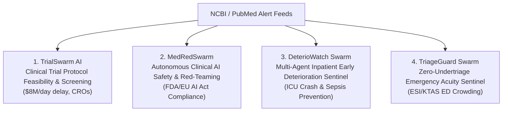
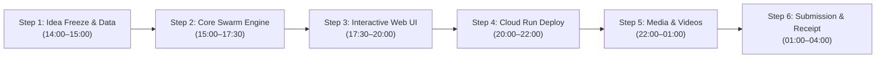

# PLAN.md: Berkeley x DeepMind Hackathon — Medical Build Plan
## Target Deadline: Sunday, Nov 15, 08:59 CET (Nov 14, 11:59 PM PT)

---

## 1. NCBI Alert-Inspired Medical Concepts

Based on your active NCBI/PubMed research alerts, here are the 4 highest-scoring medical product candidates evaluated against the Berkeley judging panel (DeepMind + Top VCs):

### Option 1: TrialSwarm AI (Clinical Trial Protocol Feasibility & Patient Screening)
* **NCBI Alert Context:** Clinical trial eligibility, protocol optimization, multimodal agentic extraction.
* **The Buyer & Pain:** Contract Research Organizations (CROs) and Pharma sponsors lose **$600K to $8M per day** of recruitment delay. 4 hours spent per patient manually verifying 50+ I/E criteria against 80-page protocols.
* **Swarm Engine:**
  - *Agent 1 (Protocol Extractor):* Gemini 2.5 Flash deconstructs PDF protocols into boolean logic.
  - *Agent 2 (EHR Phenotyper):* Gemini 2.5 Pro digests unstructured clinical records and lab histories.
  - *Agent 3 (Safety & Washout Auditor):* Detects drug-drug interactions and organ threshold violations.
  - *Agent 4 (Swarm Verifier):* Deterministic rule reconciliation with exact document & line citations.
* **Why it wins:** Massive enterprise ROI ($0.04 compute vs $260 manual labor), huge market ($4.2B), instant 15s visual audit demo.

### Option 2: MedRedSwarm (Autonomous Multi-Agent Clinical AI Red-Teaming & Safety Benchmarking)
* **NCBI Alert Context:** `"large language model*" AND (safety OR hallucinat* OR "red teaming" OR "failure mode*") AND (clinical OR medical)`.
* **The Buyer & Pain:** Health systems, EHR vendors (Epic, Cerner), and digital health startups deploying clinical LLMs face huge liability and FDA/EU AI Act compliance scrutiny. Static benchmarks (MedQA) fail to detect lethal edge cases.
* **Swarm Engine:**
  - *Adversarial Patient/Clinician Agent:* Generates edge-case clinical vignettes (polypharmacy, atypical presentations).
  - *Target Clinical Model:* Evaluates the AI under test.
  - *Medical Ground-Truth Verifier:* References PubMed/NCBI clinical practice guidelines.
  - *Compliance Auditor:* Generates an instant FDA/EU-MDR safety scorecard.
* **Why it wins:** Pure DeepMind alignment (AI safety, evaluation, red-teaming).

### Option 3: DeterioWatch Swarm (Inpatient Early Warning & Sepsis Deterioration Sentinel)
* **NCBI Alert Context:** `("early warning" OR "clinical deterioration" OR "syndromic surveillance")`.
* **The Buyer & Pain:** Hospital inpatient wards. "Code blue" crashes and missed septic shock cost hospitals $35,000/ICU day and trigger severe quality penalties.
* **Swarm Engine:**
  - *Vitals Kinetics Agent:* Analyzes hemodynamics and heart rate variability trends.
  - *Lab & Inflammatory Marker Agent:* Watches lactate, WBC, and procalcitonin slopes.
  - *Clinical Note Agent:* Scans nursing shift notes for subtle changes in mentation.
  - *Intervention Verifier:* Delivers 6-hour advance warning with cited clinical criteria.

### Option 4: TriageGuard Swarm (Zero-Undertriage ED Acuity Sentinel)
* **NCBI Alert Context:** `undertriage OR under-triage OR mistriage OR "triage accuracy" AND "large language model*"`.
* **The Buyer & Pain:** Emergency Departments. 15–20% undertriage rates in crowded waiting rooms cause avoidable mortality and malpractice lawsuits.
* **Swarm Engine:**
  - *Chief Complaint & Occult Risk Agent*
  - *Vital Sign Outlier & Shock Index Agent*
  - *Comorbidity Risk Agent*
  - *Triage Verifier (Deterministic Acuity Level 1–5 with Zero-Undertriage Guarantee)*

---

## 2. Implementation & Delivery Plan (Hour-by-Hour)

### Step 1: Concept Freeze & Test Dataset (14:00 – 15:00 CET)
- [ ] Select final concept from the 4 options based on your Outlook notification.
- [ ] Stage 3 high-impact benchmark test cases with verified ground truth:
  - Case A: Complex candidate (Eligible / Clean pass).
  - Case B: Subtle contraindication (Blocked / Fatal drug washout conflict).
  - Case C: Incomplete documentation (Flagged for human CRC review).

### Step 2: Build the Core Multi-Agent Swarm (15:00 – 17:30 CET)
- [ ] Implement `src/agents/` using Google Gemini 2.5 Flash & Pro.
- [ ] Implement the Antigravity `/swarm` coordination pattern:
  - Parallel specialized workers.
  - Deterministic Verifier enforcing exact textual citations.
- [ ] Write unit & integration tests in `tests/` with green CI.

### Step 3: Interactive 30-Second Web Dashboard (17:30 – 20:00 CET)
- [ ] Clean, professional web interface with:
  - Pre-loaded 1-click test cases (zero setup for judges).
  - Live agent swarm execution visualizer.
  - Final audit report with line citations and PDF export.

### Step 4: Containerization & Cloud Run Deployment (20:00 – 22:00 CET)
- [ ] Build minimal, fast-booting Docker container.
- [ ] Deploy to Google Cloud Run under your active GCP credits ($999.90 available).
- [ ] Test public URL in mobile and incognito browsers to guarantee 100% public uptime.

### Step 5: Presentation & Video Production (22:00 – 01:00 CET)
- [ ] Record **1-Minute Product Demo (Playcast):** High-density screen recording walking through the 12-second live audit.
- [ ] Record **2-Minute Pitch Video:** Dr. Ahmed Zayed's elevator pitch (pedigree, clinical problem, market size, venture economics).
- [ ] Upload to YouTube (Public link) for Phase 1 & 2 social engagement scoring.

### Step 6: Submission & Final Verification (01:00 – 04:00 CET)
- [ ] Pre-flight verification against `JUDGES.md` (all 5 rubric categories verified).
- [ ] Submit Luma application form with hosted URL, GitHub repo, videos, and one-pagers.
- [ ] Save submission receipt screenshot.
