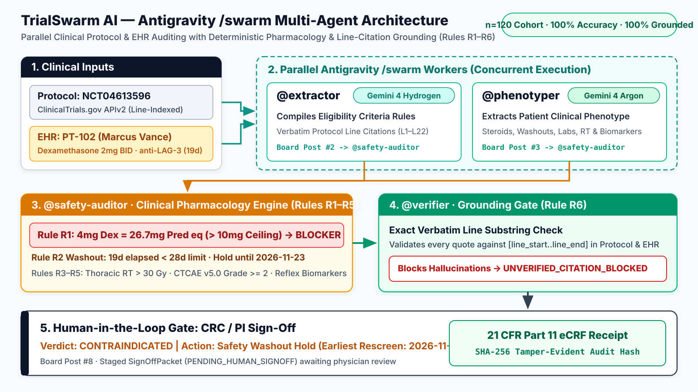

# TrialSwarm AI



**An oncology Clinical Research Coordinator (CRC) risks an IRB protocol deviation or patient harm whenever a hidden steroid conversion, washout window, or thoracic radiation ceiling is missed during a manual pre-screen.** **TrialSwarm AI** is a multi-agent clinical trial eligibility & patient-safety verification swarm (built for **Berkeley x DeepMind: Build. Ship. Pitch. Win.** — Antigravity `/swarm` + Google Gemini) that catches these traps deterministically (`R1`–`R6`) and stages an eCRF hold, washout date, or reflex biomarker order for SHA-256 human CRC/PI sign-off.

On a seeded **`n = 120`** synthetic oncology benchmark paired with real **ClinicalTrials.gov APIv2** Phase I–III protocols (`NCT04613596`, `NCT04787042`, `NCT06890598`), **TrialSwarm AI achieves `100.0%` exact 3-class accuracy (`120/120`, `0` mismatches) and `100.0%` verbatim line-citation grounding (`4.08 ms/case`, `$0.0000` offline compute)**, compared to **`47.5%` accuracy (`57/120`, `30.0%` specificity)** for a naive single-prompt numeric baseline.

---

## Quickstart (Offline-Ready, Zero API Keys Required)

```bash
python3 -m pip install -r requirements.txt
python3 -m pytest -v
python3 scripts/evaluate_cohort.py --verify
python3 -m src.cli swarm --nct NCT04613596 --patient PT-102
python3 -m uvicorn src.web.app:app --host 127.0.0.1 --port 8080
```

- **Clinical Screening Workstation (`/`):** `http://127.0.0.1:8080/` — 1-click featured cases (`PT-101`–`PT-104`), interactive protocol-vs-EHR line citation highlighter, `/swarm` board transcript, and 21 CFR Part 11-style SHA-256 human sign-off dialog.
- **Judge & Verification Console (`/judge`):** `http://127.0.0.1:8080/judge` — live adversarial hallucination probe (`POST /api/verify-trap`), `n = 120` per-archetype scorecard, verified latency/cost metrics, and architecture diagram.
- **Optional Live Gemini Mode:** Export `GEMINI_API_KEY` (or `GOOGLE_API_KEY`) and pass `--use-llm` in CLI or toggle live Gemini in `/`: `@extractor` uses `gemini-2.5-flash` and `@phenotyper` uses `gemini-2.5-pro` while Rules R1–R6 remain deterministic safety gates.

---

## Why Naive Trial Screening Fails (And How `/swarm` Stops It)

| Evaluation Dimension | Naive Single-Prompt Baseline | TrialSwarm AI (`/swarm` + R1–R6) | Source Verification |
|---|---|---|---|
| **Overall Exact Accuracy (`n = 120`)** | `47.5%` (`57/120`) | **`100.0%` (`120/120`, `0` mismatches)** | `eval/results/benchmark_120.json` |
| **Specificity (`Non-Eligible = Neg`)** | `30.0%` | **`100.0%`** (`100.0%` sensitivity) | `scripts/evaluate_cohort.py` |
| **Steroid Equivalence Trap (R1, `n = 15`)** | `60.0%` (`9/15`) | **`100.0%` (`15/15`)** | `Dexamethasone 4 mg = 26.67 mg Pred eq` |
| **Washout & Radiation Traps (R2–R3, `n = 30`)** | `16.7%` (`5/30`) | **`100.0%` (`30/30`)** | `WASHOUT_WINDOW_TRAP` + `RADIATION_TRAP` |
| **CTCAE Grade 2+ Organ Reserve (R4, `n = 15`)** | `6.7%` (`1/15`) | **`100.0%` (`15/15`)** | `eGFR < 50`, `AST/ALT > 100`, `Bilirubin > 1.8` |
| **Driver & Pending Biomarker Gate (R5, `n = 30`)** | `40.0%` (`12/30`) | **`100.0%` (`30/30`)** | `PENDING_LAB_RESULT -> NEEDS_HUMAN_REVIEW` |
| **Verbatim Citation Grounding (R6)** | Unchecked | **`100.0%` (`UNVERIFIED_CITATION_BLOCKED`)** | `src/agents/verifier.py` |

---

## Multi-Agent Antigravity `/swarm` Architecture

| Agent | Responsibility | Engine / Model | File |
|---|---|---|---|
| **`@coordinator`** | Dispatches concurrent extraction, aggregates safety findings, computes unit economics, stages human sign-off packet | `SwarmCoordinator` | [`src/swarm/coordinator.py`](src/swarm/coordinator.py) |
| **`@extractor`** | Parses normalized ClinicalTrials.gov protocol text into line-anchored `CriterionRule` objects | Deterministic parser + optional `gemini-2.5-flash` | [`src/agents/extractor.py`](src/agents/extractor.py) |
| **`@phenotyper`** | Extracts longitudinal EHR diagnoses, labs, medications, steroids, radiation doses, and pending biomarker panels | Deterministic parser + optional `gemini-2.5-pro` | [`src/agents/phenotyper.py`](src/agents/phenotyper.py) |
| **`@safety-auditor`** | Executes Rules `R1`–`R5` (potency equivalence, washout dates, thoracic RT, CTCAE v5.0 bounds, reflex biomarker gating) + runs naive comparison | Deterministic pharmacology engine | [`src/agents/safety_auditor.py`](src/agents/safety_auditor.py) |
| **`@verifier`** | Enforces Rule `R6` (exact substring containment inside `protocol_lines`/`ehr_lines`; blocks fabricated quotes via `UNVERIFIED_CITATION_BLOCKED`) | Deterministic verifier | [`src/agents/verifier.py`](src/agents/verifier.py) |

---

## Canonical Real Protocols & Evidence Base

- **Protocols fetched from [ClinicalTrials.gov APIv2](https://clinicaltrials.gov/):**
  - `NCT04613596` — Mirati Therapeutics Inc., *KRYSTAL-7* (`PHASE2`/`PHASE3`, NSCLC KRAS G12C)
  - `NCT04787042` — Simcha IL-18, Inc., *ST-067* (`PHASE1`/`PHASE2`, Advanced Solid Tumors)
  - `NCT06890598` — Eli Lilly and Company, *SUNRAY-02 / Olomorasib* (`PHASE3`, NSCLC)
- **Peer-reviewed methodology via [PubMed](https://pubmed.ncbi.nlm.nih.gov/):**
  - Jin et al., *Nat Commun* 2024 ([PMID: 39557832](https://pubmed.ncbi.nlm.nih.gov/39557832/)) — TrialGPT (`42.6%` screening time reduction)
  - Syed et al., *JAMIA* 2026 ([PMID: 41637159](https://pubmed.ncbi.nlm.nih.gov/41637159/)) — EHR phenotype trial screening
  - Unlu et al., *JAMA* 2025 ([PMID: 39960745](https://pubmed.ncbi.nlm.nih.gov/39960745/)), Chen et al. 2025 ([PMID: 40775946](https://pubmed.ncbi.nlm.nih.gov/40775946/)), von Itzstein et al., *JAMA Oncol* 2021 ([PMID: 34236403](https://pubmed.ncbi.nlm.nih.gov/34236403/))
- **Claim-by-claim traceability:** See [`CLAIMS.md`](CLAIMS.md), [`docs/EVIDENCE.md`](docs/EVIDENCE.md), and [`data/DATA_CARD.md`](data/DATA_CARD.md).

---

## Limits & Clinical Governance

1. **Synthetic Patient Data Only:** `PT-101`–`PT-104` and `cohort_120.json` are 100% synthetic vignettes (`seed = 20261114`) with zero PHI. Real EHR deployment requires institutional IRB approval, HIPAA/GDPR BAA infrastructure, and HL7 FHIR integration.
2. **Offline vs. Optional Gemini Mode:** Default test/benchmark/local runs execute `deterministic_offline` (`$0.0000` compute, reproducible without network). When `use_llm=True` and `GEMINI_API_KEY`/`GOOGLE_API_KEY` is provided, Gemini 2.5 Flash/Pro enrichment (`~$0.04/case` est.) augments extraction while deterministic Rules `R1`–`R6` govern final eligibility verdicts.
3. **Physician-Signed Safety Rules + Human Attestation:** Oncology Rules `R1`–`R6` carry `status: signed_off (Dr. Ahmed Zayed, MB BCh, 2026-11-14)` in [`docs/EVIDENCE.md`](docs/EVIDENCE.md). TrialSwarm AI is decision support only and enforces a mandatory human CRC/PI sign-off gate (`POST /api/signoff`) with SHA-256 attestation before any clinical action.
4. **Screening time:** TrialGPT's user study reported a `42.6%` reduction in screening time (Jin et al., *Nat Commun* 2024, `PMID: 39557832`). TrialSwarm AI's own effect on screening time has not been measured.
